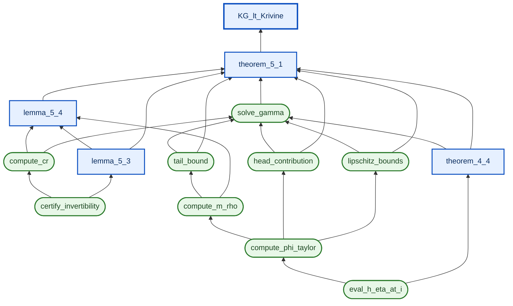

# ProofGraph

End-to-end **effective proof** of `KG < KrivineBound` (the Grothendieck-constant
upper bound), tying three artifacts into a single auditable pipeline:

- [`LeanProof/`](../LeanProof/) — the Lean 4 / Mathlib formalization of
  Braverman et al. (2011).
- [`ProofRefinement/Lemma54/`](../ProofRefinement/Lemma54/) — the
  paper-faithful effective Lean proof of Lemma 5.4 (Cauchy bounds, identity
  (75), Lagrange remainder; 12 trusted IFT-supplied analytic axioms).
- [`grothendieck/proof/certified/`](../grothendieck/proof/certified/) — the
  certified-arb (`flint.arb`) Python pipeline that produces every numerical
  constant the Lean side declares.

The graph is described declaratively (one TOML per node), audited (every
Lean theorem's `#print axioms` is checked against an allow-list per node),
and run end-to-end (Python oracles compute, Lean rationals are parsed,
cross-validation lives in [`runs/<ts>/certificate.json`](runs)).

---

## Contents

1. [Quickstart](#quickstart)
2. [The 30-second mental model](#the-30-second-mental-model)
3. [Layout](#layout)
4. [The graph](#the-graph)
5. [How a node is wired](#how-a-node-is-wired)
6. [The CLI](#the-cli)
7. [Lean side ↔ Python side: the bridge](#lean-side--python-side-the-bridge)
8. [Axiom budget](#axiom-budget)
9. [Common workflows](#common-workflows)
10. [Onboarding for a coding agent](#onboarding-for-a-coding-agent)
11. [Outstanding work](#outstanding-work)
12. [References](#references)

---

## Quickstart

From the project root:

```bash
# Build the mixed Lean library used by the audit / effective files.
# Note: the explicit `γ` / `Cr` chain is sorry-free, but the final
# Grothendieck-inequality sink still inherits 2 known sorries from
# `LeanProof/Rounding.lean`.
lake build ProofGraph

# Audit: print the axioms each Lean theorem in the graph actually uses
# and check them against the allow-lists in nodes/*.toml.
PYTHONPATH=ProofGraph uv run python -m ProofGraph.proof_graph --audit-snapshot

# Full end-to-end run: parse Lean rationals, run every wired Python oracle,
# evaluate symbolic Lean defs, cross-validate, write certificate.json.
PYTHONPATH=ProofGraph uv run python -m ProofGraph.proof_graph --run-all
```

`--audit-snapshot` should report all Lean-backed nodes passing with no
unexpected axioms. `--run-all` should report all cross-validations passing.
If either fails, see the
[Common workflows](#common-workflows) section for triage.

> **PYTHONPATH note.** The Python framework lives at
> `ProofGraph/proof_graph/` (lowercase) but is invoked as the package
> `ProofGraph.proof_graph` (mixed-case). Some node TOMLs reference oracle
> wrappers as `proof_graph.oracle_wrappers` (lowercase), so `ProofGraph/`
> needs to be on `PYTHONPATH`. The `PYTHONPATH=ProofGraph` prefix above
> handles this. Without it, the runner falls back to a top-level `--audit`
> mode but `--run-all` will report `ModuleNotFoundError`.

---

## The 30-second mental model

We have a **proof DAG** (read leaves → sink):

```
                 ┌─────────────┐
                 │ KG_lt_Krivine│   ← top-level: K_G < π/(2·log(1+√2))
                 └──────┬───────┘
                        │
                 ┌──────┴───────┐
                 │ theorem_5_1  │   ← ∃ γ > log(1+√2) with summability
                 └──────┬───────┘
                        │
        ┌───────────────┼───────────────┬─────────────────┐
   lemma_5_4       theorem_4_4     solve_gamma     ... etc.
   (Cr·p² bound)   (η-improvement) (γ via IVT)
```

Each node has two flavours of evidence:

- **Lean evidence**: a theorem (`<sink>`) plus an effective companion
  (`<effective>`) that instantiates it at concrete rationals. The
  effective companion may add **oracle axioms** — assertions that
  named numerical bounds hold, verified by Python.
- **Python evidence**: a certified-arb computation that recomputes the
  bound and feeds it into a `certificate.json`.

The `audit` command checks the Lean side: `#print axioms <theorem>` must
match the TOML's `allowed_axioms` list. The `run-all` command checks
the Python side and the bridge: every numerical constant the Lean side
*declares* must be reproduced (and dominated) by the Python side.

Important: today the active Lean path uses one concrete oracle rectangle
`Ω(delta_val, B_val)` and imports three oracle-side facts: containment of
the `F_inv_paper` image in that rectangle, the single-`M` bound on that
same rectangle, and the `H_η(i)/i` improvement bound. The
`solve_gamma` / `head_contribution` / `tail_bound` / `lipschitz_bounds`
branch currently certifies a parallel numerical witness, but it is not yet
the explicit witness used by `Theorem51Effective.lean`.

---

## Layout

```
ProofGraph/
├── README.md                     # this file
├── DESIGN.md                     # high-level design (legacy stub → docs/)
├── proof_graph/                  # Python framework (CLI, graph, oracle, audit)
│   ├── __main__.py / cli.py      # entry point: --list-order, --audit-snapshot,
│   │                             #              --run-python, --run-all, --render
│   ├── graph.py / node.py        # parse TOML → typed Node / Graph
│   ├── lean_bridge.py            # spawn `lake env lean` for #print axioms
│   ├── audit.py                  # axiom audit (per-node allow-list check)
│   ├── oracle.py                 # invoke a node's Python function with wired inputs
│   ├── oracle_wrappers.py        # wrappers around grothendieck/proof/certified/* fns
│   ├── cert_compute.py           # mirror Lean defs in arb (Cr_paper, Cr_refined,
│   │                             #   R_val_paper, KG_upper, Krivine_bound, …)
│   ├── effective_parser.py       # extract `def NAME : ℝ := <expr>` from
│   │                             #   ProofGraph/Effective/*.lean (rational or symbolic)
│   ├── runner.py                 # --run-all: parse + run + cross-validate
│   └── render.py                 # --render mermaid|dot
├── nodes/                        # one TOML per node (declarative)
│   ├── _index.toml               # global config (sink, constants, axiom inheritance)
│   ├── certify_invertibility.toml
│   ├── compute_cr.toml
│   ├── compute_m_rho.toml
│   ├── compute_phi_taylor.toml
│   ├── eval_h_eta_at_i.toml
│   ├── head_contribution.toml
│   ├── kg_lt_krivine.toml
│   ├── lemma_5_3.toml
│   ├── lemma_5_4.toml
│   ├── lipschitz_bounds.toml
│   ├── solve_gamma.toml
│   ├── tail_bound.toml
│   ├── theorem_4_4.toml
│   └── theorem_5_1.toml
├── Effective/                    # Lean library: companion theorems + oracles
│   ├── Lemma53Effective.lean
│   ├── Lemma54Effective.lean         # eta_val, r_val, delta_val, B_val, M_val, Cr_val
│   ├── Lemma54PaperBridge.lean       # lemma_5_4_strong_via_paper_on_domain
│   ├── Theorem44Effective.lean       # h_eta_strict_improvement_oracle
│   ├── Theorem51Effective.lean       # extracts γ_val via Classical.choose
│   ├── Theorem51PaperEffective.lean  # ~180-line re-derivation through the paper bridge
│   └── KGBound.lean                  # KG_lt_Krivine_effective, KG_upper_val
├── runs/                         # outputs of --audit-snapshot / --run-all (gitignored)
│   └── <iso-timestamp>/{audit,certificate}.json
└── tests/                        # unit tests for the Python framework
```

**Symmetry to keep in mind.** Each Lean theorem in the graph has a *sink*
(the abstract statement) and an *effective* (the concrete instantiation).
The audit runs `#print axioms` on both. The TOML's `allowed_axioms` list
is the union — sink axioms are typically a subset (Lean primitives + IFT
axioms), effective adds the oracle axioms.

---

## The graph

```
nodes/_index.toml: sink_node = "kg_lt_krivine"
```



**Node kinds.**
- `kind = "computational"` (green) — has a Python oracle wired via `[python]`.
  Outputs are arb intervals; consumed by other nodes via
  `node:<slug>:<output>` references.
- `kind = "statement"` (blue) — has a Lean theorem as sink and (optionally)
  an effective companion. May or may not have a `[python]` block.

The sink node is `kg_lt_krivine`; the *Lean* sink is
`Braverman.KG_lt_Krivine` (in `LeanProof/MainTheorem.lean`). The
effective companion is `Braverman.Effective.KG_lt_Krivine_effective`
(in `Effective/KGBound.lean`).

---

## How a node is wired

A node is one TOML file. Example: [`nodes/lemma_5_4.toml`](nodes/lemma_5_4.toml):

```toml
name      = "Lemma 5.4 (paper-faithful)"
slug      = "lemma_5_4"
kind      = "statement"
paper_ref = "Braverman et al. (2011), Lemma 5.4 / eqs. (75)–(76)"

parents = ["lemma_5_3", "compute_cr", "compute_m_rho"]

[lean]
sink           = "Braverman.Paper.lemma_5_4_paper"
file           = "ProofRefinement/Lemma54/Proof/Lib/Lemma54_Paper_Main.lean"
line           = 87
effective      = "Braverman.Effective.lemma_5_4_effective"
effective_file = "ProofGraph/Effective/Lemma54Effective.lean"

[audit]
allowed_axioms = [
  "@axioms.lean_primitives",           # propext, Classical.choice, Quot.sound
  "@axioms.trusted_analytic",          # 12 IFT-supplied F_inv_paper_* axioms
  "Braverman.Effective.h_M_oracle",    # certified single-M sup-norm bound
]
```

A computational node has a `[python]` block instead of `[lean]`:

```toml
[python]
module   = "grothendieck.proof.certified.compute_cr"
function = "compute_Cr_full"

[python.inputs]
r     = { source = "node:certify_invertibility:r_arb" }
delta = { source = "node:certify_invertibility:delta_arb" }
B     = { source = "node:certify_invertibility:B_arb" }

[python.kwargs]
prec    = 256
verbose = false

[python.outputs]
M   = "M"
R   = "R"
C_r = "C_r"   # extract result["C_r"] from the function's return value
```

**Input wiring grammar.**
- `"const:<key>"` — pull from `_index.toml` `[constants]`. With optional
  `cast = "float" | "int" | "str"`.
- `"node:<slug>:<output>"` — pull from another node's output (which has
  already been run; the runner walks topologically).

**Output extraction.**
- A bare key (e.g. `"C_r"`) — `result["C_r"]`.
- Dotted (`"meta.M_diff"`) — nested attribute / dict access.
- `"tuple_index:<i>"` — for functions returning a tuple.

**Allowed-axioms inheritance.** Strings starting with `@axioms.` are
expanded against `_index.toml`'s `[axioms]` table:

```toml
[axioms]
lean_primitives = ["propext", "Classical.choice", "Quot.sound"]
trusted_analytic = [
  "Braverman.Paper.F_inv_paper",
  "Braverman.Paper.F_inv_paper_eq",
  ...    # 12 total
]
```

So a node lists `"@axioms.trusted_analytic"` once and inherits all 12.

---

## The CLI

The Python entry is `python -m ProofGraph.proof_graph` (or
`python -m proof_graph` if `ProofGraph/` is on `PYTHONPATH`). Available
commands:

| Flag                        | What it does                                                                  |
|---|---|
| `--list-order`              | Print node slugs in topological order (leaves first).                          |
| `--audit-snapshot`          | For every Lean-backed node: run `#print axioms`, compare against TOML allow-list, write `runs/<ts>/audit.json`. |
| `--run-python --node <slug>`| Run one Python oracle and dump its output.                                     |
| `--run-all`                 | Parse Lean rationals + run every wired oracle topologically + cross-validate + write `runs/<ts>/certificate.json`. |
| `--render mermaid \|dot --out <file>` | Render the graph (auto-annotated with axiom counts).                |
| `--node <slug>`             | Restrict to a subgraph (works with `--audit-snapshot` and `--run-python`).     |
| `--no-write`                | Skip writing the JSON snapshot (still prints to stdout).                       |
| `--verbose`                 | Echo every shell-out and oracle invocation.                                    |

Output JSON files are written to `runs/<UTC-timestamp>/`. They're
gitignored (run history accumulates locally).

---

## Lean side ↔ Python side: the bridge

The two artifacts agree at three places:

### 1. The Lemma 5.4 constant `Cr_paper`

**Lean** ([Lemma54_Paper.lean](../ProofRefinement/Lemma54/Proof/Lib/Lemma54_Paper.lean)):

```lean
def Cr_paper (r M R : ℝ) : ℝ :=
  8 * M ^ 2 * R / (1 - r) ^ 2 * (1 + 16 * R / (1 - r) ^ 3)
```

This is Braverman et al. (2011) p.23's literal closed-form constant.
In the active effective path, `M` is assumed on an explicit oracle
domain and `R = sinh((3+r)/4)`.

**Python** ([cert_compute.py](proof_graph/cert_compute.py:Cr_paper)):

```python
def Cr_paper(r, M, R, prec=256):
    """Same formula, evaluated as an arb interval."""
```

The runner parses [`Lemma54Effective.lean:Cr_val`](Effective/Lemma54Effective.lean)
(a `def` with the symbolic body `Cr_paper r_val M_val (R_val_paper r_val)`),
recognizes the syntax via [`evaluate_symbolic`](proof_graph/cert_compute.py),
and produces a numerical arb interval.

> A separate `Cr_refined(r, M_diff, M_diffp, M_pp, R)` function is kept
> in `cert_compute.py` for the older 4-arg refined formula (which uses
> sup-norms of *differences* `H_η − H_0` and is `O(η²)` tighter at small
> `η`). The refined Lean variant lives in
> [`Lemma54_Refined.lean`](../ProofRefinement/Lemma54/Proof/Lib/Lemma54_Refined.lean)
> and is *not* on the active proof-graph path — but the closed-form `def`
> stays around in `Lemma54_Paper.lean` so a future agent can switch back.

### 2. The η-improvement bound

`Theorem44Effective.lean:h_eta_strict_improvement_oracle` asserts that
`H_η(eta_val)(i)/i > log(1+√2)`. The runner cross-checks via
[`eval_h_eta_at_i.toml`](nodes/eval_h_eta_at_i.toml) which calls
`grothendieck.proof.certified.h_eta_evaluator.eval_h_eta_at_i_arb`.

### 3. Concrete rationals (`r_val`, `eta_val`, `M_val`, …)

Every `def NAME : ℝ := <literal-rational>` in `Effective/*.lean` is
parsed by [`effective_parser.py`](proof_graph/effective_parser.py) into a
Python `Fraction`. The runner cross-checks them against the
`[constants]` table in `_index.toml` (e.g., `r_val_matches_constant`).
For `M_val`, the runner also checks that the oracle-side computed single-`M`
bound from `compute_cr` is dominated by Lean's chosen rational witness.

---

## Axiom budget

After the post-Apr-2026 migration to the **paper-faithful single-`M`** version,
and the follow-up concretization of the Lemma 5.4 oracle rectangle,
the `kg_lt_krivine` effective theorem transitively pulls in **19 axioms**:

| Group                              | Count | Source                                          |
|---|---:|---|
| Lean primitives                    | 3    | `propext`, `Classical.choice`, `Quot.sound` (always present)|
| Trusted analytic (IFT)             | 12   | `Braverman.Paper.F_inv_paper{,_eq,_zero,_mem_S,_R_bound,_analytic,_contdiff,_first_deriv_zero,_at_origin,_pr,_pr_pos,_pr_le_one}` in [Lemma54_Paper.lean](../ProofRefinement/Lemma54/Proof/Lib/Lemma54_Paper.lean) |
| Oracle: Lemma 5.4 image containment | 1   | `Braverman.Effective.h_oracle_domain_contains_image` in [Lemma54Effective.lean](Effective/Lemma54Effective.lean) |
| Oracle: M sup-norm (single)        | 1    | `Braverman.Effective.h_M_oracle` in [Lemma54Effective.lean](Effective/Lemma54Effective.lean) |
| Oracle: η-improvement              | 1    | `Braverman.Effective.h_eta_strict_improvement_oracle` in [Theorem44Effective.lean](Effective/Theorem44Effective.lean) |
| `sorryAx` (currently on the final sink path) | 1    | `LeanProof/Rounding.lean` (Gaussian-measure existence + a pull-back step; both non-quantitative). |

The audit (`--audit-snapshot`) verifies this exact set per node.
Run `--audit-snapshot` and look at `kg_lt_krivine [eff] (19 ax): …`.

The explicit bound chain through `η`, `r`, the concrete rectangle
`Ω(delta_val, B_val)`, `M`, `Cr_paper`, and `γ > log(1+√2)` is intended
to be oracle-backed.
The remaining `sorryAx` enters only when packaging that witness into the
final `GrothendieckIneq` statement via `Rounding.lean`.

> **What the IFT axioms encode.** The implicit function theorem applied
> to `(p, w) ↦ F_p η p w` near `(0, sin z)` produces a joint-regular
> family `F_inv_paper : ℝ → ℂ → ℂ` that's analytic in `z` and `C²` in
> `p`, satisfying the right-inverse identity. We axiomatize the
> existence and 11 specific consequences (see the file). The Step 5
> bound on `‖∂²_p F_inv‖` is *derived*, not axiomatized — it uses the
> auxiliary z-identity `DD·h² + D·u_zz = 0` from differentiating
> `F_p ∘ F_inv = id` twice in `z`, plus the form-A identity
> `D·u'' = -(2 Φ' u' + DD u'²)`, plus recentred Cauchy estimates,
> plus the algebraic inequality `(2R+1)(1-r)³ ≤ 16R`. See
> [Lemma54_Paper_Pderiv_Single.lean](../ProofRefinement/Lemma54/Proof/Lib/Lemma54_Paper_Pderiv_Single.lean).

---

## Common workflows

### A. Tighten an oracle bound (e.g., `M_val`)

The current `M_val = 4000` in [`Lemma54Effective.lean`](Effective/Lemma54Effective.lean)
is a clean round above the certified `compute_M_rigorous` upper of ~3600
on the active rectangle `Ω(57/1000, 293/250)`.
To tighten:

1. Run `--run-all`. Read the "Lean derived (arb intervals)" block — it
   shows `Cr_val ≈ 8.19·10¹⁴` at `M_val=4000`.
2. Read the `compute_cr.M` output in the certificate (or re-run the
   `compute_cr` node in isolation) to get a tighter certified `M`.
3. Edit `Lemma54Effective.lean` line `def M_val : ℝ := <new value>`.
4. `lake build ProofGraph` (≈ 1 min).
5. Re-run `--audit-snapshot` (axioms unchanged) and `--run-all`
   (cross-validation passing).

The oracle axioms `h_oracle_domain_contains_image` and `h_M_oracle`
don't need structural changes when `M_val` is tightened. They only
assert that the fixed oracle domain contains the relevant `F_inv_paper`
image and that *whatever rational `M_val` is set to* is a valid
single-`M` bound on that domain.

### B. Add a new computational node

1. Write the Python function in `grothendieck/proof/certified/`
   (or `ProofGraph/proof_graph/oracle_wrappers.py` for thin shims).
2. Create `nodes/<slug>.toml` with `kind = "computational"`, `[python]`
   block, and `[python.inputs]` / `[python.outputs]`.
3. Add `<slug>` to relevant downstream nodes' `parents = [...]`.
4. `--run-python --node <slug>` to test in isolation, then `--run-all`.

### C. Add a new statement node (a Lean theorem)

1. Write the theorem in Lean (statement + effective companion).
2. Create `nodes/<slug>.toml` with `kind = "statement"`, `[lean]`
   block (sink, file, line, effective, effective_file), `[audit]`
   `allowed_axioms`.
3. Add to downstream `parents`.
4. `--audit-snapshot` to verify the actual axiom set matches.

### D. The audit reports `unexpected_axioms`

Cause: the Lean proof now uses an axiom that's not in the TOML's
allow-list. Two possibilities:

- **Legitimate**: a new oracle axiom was added intentionally. Update
  the TOML.
- **Accidental**: a `sorry` or a stray non-constructive Mathlib import.
  Investigate the proof; a sorry means it's incomplete.

### E. The runner fails with `ModuleNotFoundError: No module named 'proof_graph'`

Cause: nodes that go through `proof_graph.oracle_wrappers` need
`ProofGraph/` on `PYTHONPATH`. Always invoke as:

```bash
PYTHONPATH=ProofGraph uv run python -m ProofGraph.proof_graph --run-all
```

(or set `PYTHONPATH` in your shell once.)

### F. The Lean build is slow / heartbeats out

`Lemma54_Paper_Pderiv_Single.lean` is the slow file (~30s elaboration).
It's already at `set_option maxHeartbeats 1600000`. If you see
heartbeats failures, either bump that further or split the offending
calc block into smaller `have` lemmas.

### G. Replace the placeholder `M_val` with a tight Python-derived rational

`compute_M_rigorous` (in [`grothendieck/proof/certified/compute_cr.py`](../grothendieck/proof/certified/compute_cr.py))
returns an arb. Convert to a sound rational upper bound via
`arb_to_rational_ub` (or use `arb.str(N)` and round up). The certificate
now exposes `compute_cr.M`, so tightening is mostly a matter of choosing
the replacement rational and updating Lean; see
[Outstanding work](#outstanding-work).

---

## Onboarding for a coding agent

Read these in order, in a fresh session:

1. **This README** — the high-level mental model + commands.
2. [`docs/PROOF_GRAPH_DESIGN.md`](../docs/PROOF_GRAPH_DESIGN.md) — the
   deep design rationale (why TOML, why arb-only, why effective companions).
3. [`docs/PROOF_REFINEMENT_DESIGN.md`](../docs/PROOF_REFINEMENT_DESIGN.md) —
   the older, narrower proof-graph design for Lemma 5.4 alone (the
   refinement workflow this generalises).
4. The Lean Step 5 file
   [`ProofRefinement/Lemma54/Proof/Lib/Lemma54_Paper_Pderiv_Single.lean`](../ProofRefinement/Lemma54/Proof/Lib/Lemma54_Paper_Pderiv_Single.lean)
   — the fresh paper-faithful derivation. Auxiliary z-identity →
   form-B norm bound → Cauchy bounds → algebraic step. ~600 lines.
5. The bridge
   [`ProofGraph/Effective/Lemma54PaperBridge.lean`](Effective/Lemma54PaperBridge.lean)
   — how `lemma_5_4_paper` is reshaped into the form
   `theorem_5_1_paper_effective` consumes.

**House rules to internalise.**

- Never `float()` an `arb`. Use `certified_gt`, `certified_lt`,
  `arb_to_rational_ub`, `arb.str(N)`. Float conversion silently
  truncates the certified ~10⁻³⁸ improvement margin.
  See [`feedback_arb_no_float.md`](../.claude/projects/-home-rsaha-projects-grothendieck/memory/feedback_arb_no_float.md).
- Only axiomatise differentiability/analyticity facts ("standard analytic
  facts a real paper would gloss over"). Big numerical-bound axioms
  defeat the point — derive instead. The 12 IFT axioms are the only
  exception (and they're labeled trusted_analytic).
- Use the Lean LSP MCP (`lean_diagnostic_messages`, `lean_goal`,
  `lean_multi_attempt`) for fast feedback while editing — `lake build`
  alone takes minutes; the LSP gives diagnostics in seconds.
- Convert relative dates to absolute when saving memory (`Thursday` →
  `2026-03-05`), so memory remains interpretable later.

**Common gotchas.**

- `proof_graph.module` (lowercase) vs `ProofGraph.proof_graph` (mixed).
  TOMLs use lowercase; CLI invocation uses mixed-case package path.
- `Cr_paper` (3-arg, paper-faithful) vs `Cr_refined` (4-arg, tighter
  but uses M_diff, M_diffp, M_pp). Don't confuse them — use the file's
  active definitions.
- The active effective path no longer states Lemma 5.4 on
  `F_inv_envelope`; it uses the concrete rectangle
  `Braverman.Omega delta_val B_val` plus a separate image-containment
  oracle. The remaining task is to expose the surviving rectangle-side
  assumptions as first-class certificate fields.
- `M_val = 4000` is a placeholder. The paper-faithful Cr is much larger
  than the refined Cr (~10¹⁵ vs ~0.15). Don't expect the paper
  numbers to be tight — that's why the refined formula exists for
  numerical work.

---

## Outstanding work

Roughly in priority order:

1. **Turn the concrete Lemma 5.4 rectangle into a first-class certificate
   boundary.** The Lean side now uses the explicit rectangle
   `Braverman.Omega delta_val B_val`, and the runner already checks that
   `delta_val`, `B_val`, and the Step 1 rectangle agree. What is still
   missing is a standardized certificate field for the remaining oracle
   assumptions `h_oracle_domain_contains_image` and `h_M_oracle`.

2. **Replace the opaque Lean `γ` witness by an explicit certificate-backed
   witness.** `solve_gamma` currently produces a rigorous numerical witness
   `gamma_best`, but `Theorem51Effective.lean` still extracts `gamma_val`
   via `Classical.choose`. The right long-term shape is: factor the
   theorem into a generic analytic lemma plus a small effective
   instantiation whose numeric hypotheses are discharged by oracle facts.

3. **Tighten `M_val`.** Replace the placeholder `4000` with a tight
   rational derived from `compute_M_rigorous`. `compute_cr` now exposes
   `M`, so the runner can check the bridge honestly. Tightening `M`
   shrinks `Cr_val` quadratically (sensitive to `M²`).

4. **Reconnect the refined pipeline (optional).** `Cr_refined` (the
   tighter formula) is mathematically `O(η²)` better than `Cr_paper`.
   The refined Lean theorem `lemma_5_4_refined` is fully proved; the
   refined Python `Cr_refined` exists. A parallel proof-graph track
   (`lemma_5_4_refined.toml`) could expose this as an alternative
   sink with a much smaller numerical headline. Useful when the
   tightness matters (e.g., for evolutionary search of `(η, r)`).

5. **`Rounding.lean` sorries.** Two non-quantitative sorries remain
   (Gaussian-measure existence + a pull-back step). They are not on the
   explicit-constant side of the proof, but they are still on the final
   sink path. Filling them removes the last `sorryAx` from the audit and
   is required if the trust base is meant to consist only of analytic
   axioms plus numerical oracles.

6. **More cross-validation checks.** `--run-all`'s current checks are
   conservative. Useful additions:
   - Strict comparison `Cr_val < some_threshold * compute_cr.C_r`.
   - Verify `head_contribution + tail_bound + lipschitz_bounds·δ`
     remains below the η-improvement margin (currently checked only
     indirectly via `KG_improvement_mid > 0`).

---

## References

- **Braverman, Ozanne, Naor (2011)**, *Grothendieck's inequality* (the
  paper). Lemma 5.4 lives on p.23. PDF: [`assets/pdf/braverman.pdf`](../assets/pdf/braverman.pdf).
- **Internal docs**:
  - [`docs/PROOF_GRAPH_DESIGN.md`](../docs/PROOF_GRAPH_DESIGN.md) — full design.
  - [`docs/PROOF_REFINEMENT_DESIGN.md`](../docs/PROOF_REFINEMENT_DESIGN.md) — the
    Lemma-5.4-only refinement framework this generalises.
  - [`docs/CERTIFIED_PROOF_PIPELINE.md`](../docs/CERTIFIED_PROOF_PIPELINE.md) — the 10-step certified pipeline.
  - [`docs/LEMMA54_LEANIFICATION_PLAN.md`](../docs/LEMMA54_LEANIFICATION_PLAN.md) — the
    plan for the formalization of Lemma 5.4 itself.
  - [`ProofGraph/STATUS_AND_PLAN.md`](STATUS_AND_PLAN.md) — current rigor
    boundary, recent changes, and the roadmap to a fully rigorous
    effective bound.
- **Lean files of note**:
  - Sink (abstract): [`LeanProof/MainTheorem.lean`](../LeanProof/MainTheorem.lean) — `KG_lt_Krivine`.
  - Sink (effective): [`ProofGraph/Effective/KGBound.lean`](Effective/KGBound.lean) — `KG_lt_Krivine_effective`.
  - Lemma 5.4 paper-faithful: [`ProofRefinement/Lemma54/Proof/Lib/Lemma54_Paper_Main.lean`](../ProofRefinement/Lemma54/Proof/Lib/Lemma54_Paper_Main.lean).
  - Step 5 derivation: [`ProofRefinement/Lemma54/Proof/Lib/Lemma54_Paper_Pderiv_Single.lean`](../ProofRefinement/Lemma54/Proof/Lib/Lemma54_Paper_Pderiv_Single.lean).
- **Python files of note**:
  - Cr formula mirror: [`ProofGraph/proof_graph/cert_compute.py`](proof_graph/cert_compute.py).
  - Certified Cr pipeline: [`grothendieck/proof/certified/compute_cr.py`](../grothendieck/proof/certified/compute_cr.py).
  - Runner: [`ProofGraph/proof_graph/runner.py`](proof_graph/runner.py).

---

## Status (Apr 2026)

- Lean: `lake build ProofGraph` succeeds.
- Axiom spot-checks: the Theorem 5.1 effective theorem has the intended
  analytic + oracle axiom set; the final sink has the same set plus
  `sorryAx` from `Rounding.lean`.
- Bridge: `compute_cr` exposes `M`, `R`, `C_r`, and the runner now
  checks that the oracle-side `M` is dominated by Lean's chosen `M_val`.
  The active effective path uses the concrete rectangle
  `Braverman.Omega delta_val B_val` plus the image-containment oracle,
  not the old `F_inv_envelope` statement.
- The numerical `solve_gamma` branch currently certifies a rigorous
  sidecar witness; it is not yet the explicit witness used in Lean.
- Migration to **paper-faithful single-`M`** version completed Apr 2026
  (replaced the previous 3-bound refined formulation throughout
  Effective/, the bridge, the TOML allow-lists, and the Python
  helpers). The refined formula stays available as `Cr_refined` in
  both Lean and Python for future use.
